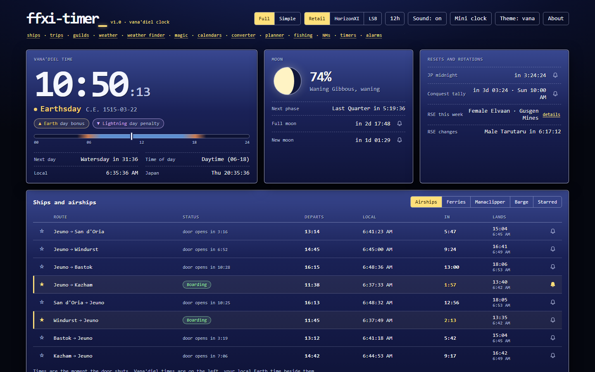

# ffxi-timer v0.6

A Vana'diel clock and schedule board for Final Fantasy XI: the time, the moon, every airship and ferry, guild and shop hours, RSE, weather and where to find it, a planner for lining conditions up, and alarms. It follows in the footsteps of Pyogenes' [FFXI Time Information](https://www.pyogenes.com/ffxi/timer/v2.html) page, rebuilt with current schedule data.

**Use it: [radmageirl.github.io/ffxi-timer](https://radmageirl.github.io/ffxi-timer/)**



It is a plain HTML page with no build step and no server. Everything is worked out in the browser from the Earth clock; nothing is fetched and nothing is sent anywhere, except alarm posts to a Discord webhook if you set one. Settings, starred routes and alarms stay in that browser's local storage.

## What it shows

**Vana'diel now**
- The time and C.E. date, the weekday's day bonus and day penalty elements, daytime or nighttime, and a countdown to the next day
- The moon's percent and phase, drawn, with the next phase change and when the next full and new moons begin
- JP midnight, the weekly conquest tally (Monday 00:00 JST), and this week's RSE race and dungeon

**Ships and airships**
- All 8 airships (Kazham included), the Selbina, Mhaura, Aht Urhgan Whitegate and Nashmau ferries, the Manaclipper and the Phanauet barge
- Boarding status, the departure in Vana'diel and local time with a countdown, and when you land
- Star the routes you use to keep them on their own tab and in the mini clock

**Trips**
- Pick two ports and it lists the next five trips between them by boat and airship, changing where one lands and the next leaves: Port Bastok to Kazham changes airships in Port Jeuno, and Selbina to Nashmau takes three ferries
- Each leg's departure, where to change and how long the wait is, when you land, and how long it all takes, with a setting for how long you need to walk between docks
- Walking between towns and teleports aren't counted, so To only lists ports a boat or airship can reach

**Guilds and shops**
- 22 guild shops, including the ones in Mhaura, Selbina, Al Zahbi, Whitegate, Bibiki Bay and Carpenters' Landing, plus the Tenshodo, linkshell, chip and ferry fishing merchants that keep hours
- Each NPC's name, hours and holiday, open, closed or holiday right now, and the next open stretch in your local time

**Weather**
- A forecast for 218 zones: for each Vana'diel day, the usual, common and rare weather, with double weather in bold
- Each zone's weather follows a fixed 2,160-day cycle and the game switches among a day's three weathers, so this is a forecast of odds, not a promise
- Outside cities, LandSandBoat servers turn Clear, Sunshine and Clouds into Fog from 02:00 to 07:00; the forecast says so for each zone it applies to
- Press **Star zone** in the Weather panel to keep a zone's weather for today and tomorrow at the top of the page, in the converter and in the mini clock

**Weather finder**
- Click any weather anywhere on the page, or pick several, to see which zones are most likely to have it and when
- Soonest chances first: zones where it is always on (the cloisters, Dynamis, Temenos), then days where it is the usual weather, then common, then rare, with runs of days merged
- Where it is most common: zones ranked by how much of the 2,160-day cycle they are likely to have it, with each zone a link to its forecast

**Calendars and RSE**
- Day, moon and RSE calendars, filterable by weekday, phase or race
- RSE details for any week: the chest key to trade, every monster that drops it, your race's set pieces, and the ??? that pops the sachet NM
- **Add to calendar** downloads the listed days, moon phases or RSE weeks as an .ics file for Google Calendar, Outlook or Apple Calendar, each with a reminder

**Converter**
- One moment in Earth and Vana'diel time: change either side and the other follows
- Shows that moment's weekday, moon and your starred zones' weather, and how long until or since it

**Planner**
- Pick weekdays, an hour range, moon phases or a moon percent, and a zone's weather; it lists when they next line up in Earth time
- Weekdays, the moon and weather all repeat within 15,120 Vana'diel days and the planner searches all of them, so "never" means never
- **Save** keeps a search beside the presets, and each saved search can have its own alarm
- **Add to calendar** downloads the next eight windows as an .ics file
- **Copy link** shares a planner search, a zone's forecast or a weather finder search as a URL

**Fishing**
- Pick any of the 100 fish you can catch on a LandSandBoat server to see its skill level, size, rarity and key item, and the baits and lures that hook it, strongest first
- Every spot where it bites, soonest first: the next best fishing moon (Waxing Gibbous and Full Moon) together with rain or a squall in that zone, or the best moon alone where it never rains
- **Plan** opens that search in the planner, where it can have an alarm
- You hook fish most often from Waxing Gibbous through Full Moon and least at New Moon and Waning Crescent; rain helps a little and a squall a little more; bites come sooner at New Moon and Full Moon, and at 05:00 and 17:00

**Alarms**
- A bell on any departure, shop opening, reset, moon phase or planner window
- A toast, a chime and a browser notification, plus an optional post to a Discord channel through a webhook, switchable per alarm
- A **Mini clock** that stays on top of the game window (Chrome and Edge) and shows your starred routes and zones

**Simple view**
- The **Simple** pill in the toolbar keeps the clock, moon and resets, and puts every departure in the order they leave, the 22 guilds and the next eight days with your starred zones' weather on one screen
- It is remembered in that browser; `?simple` at the end of the address opens it directly

**Themes**: system, light, dark and Vana'diel (the game's blue menu windows) on the **Theme** button.

## Accuracy

The time math matches the LandSandBoat server: its epoch (886-01-01 00:00 is 2001-12-31 15:00 UTC), its moon cycle and its RSE rotation. The tests check them against Pyogenes' own reference dates, BG Wiki's moon table and the in-game ferry timekeeper schedules.

Departure times are when the boarding door shuts, from the retail packet captures LandSandBoat records for each run. They sit a few Vana'diel minutes after the round numbers older timers list: the Jeuno to San d'Oria airship leaves at 01:14, not 01:10.

Fixed compared with the old timer:

- 38% waxing is a Waxing Crescent everywhere; the old page's moon display calls that day a First Quarter while its day calendar calls it a Waxing Crescent
- The old page rebuilds every panel's HTML 20 times a second, and lists flickering in Mozilla as a known issue; this one rewrites only the text that changed
- The Aht Urhgan ferries, the Manaclipper, the barge, the outlying guild shops, weather and the weather finder are all new

## Changes

What changed in each version is in [CHANGELOG.md](CHANGELOG.md).

## Run it locally

Download or clone this repository and open `index.html` in a modern browser. There is no install step.

Alarms and Discord posts only fire while the page is open. The mini clock uses Document Picture-in-Picture where the browser has it and a small popup window everywhere else.

## Shortcuts

| Key | Action |
| --- | --- |
| `S` | Switch between the simple and full view |
| `T` | Cycle the theme |
| `M` | Open the mini clock |
| `?` | About |

## Tests

```
node tests/run.mjs
```

No dependencies. The tests cover the clock, moon, RSE, resets, every ship schedule, shop hours, weather, the weather finder, morning fog, trips, fishing, the planner, the converter, calendar files, and the counts the About dialog states.

`weather-data.js` is generated by `tools/build-weather.mjs` from LandSandBoat's `sql/zone_weather.sql`, `data/enums/zone.yaml` and the `data/zones` folder (for which zones are cities); the script checks every zone and day against its source before it writes.

`fishing-data.js` is generated by `tools/build-fishing.mjs` from LandSandBoat's fishing tables in `sql/` and the zone and key item names in `data/enums/`; it keeps only fish the server can hook, and checks its output against the tables.

## Data

Ship schedules, shop hours, chest key drops, the RSE quest steps, the weather cycles and the fishing tables come from [LandSandBoat](https://github.com/LandSandBoat/server)'s data and scripts. The code here is my own.

FINAL FANTASY is a registered trademark of Square Enix. This project is not affiliated with Square Enix.

## License

MIT. See [`LICENSE`](LICENSE).
